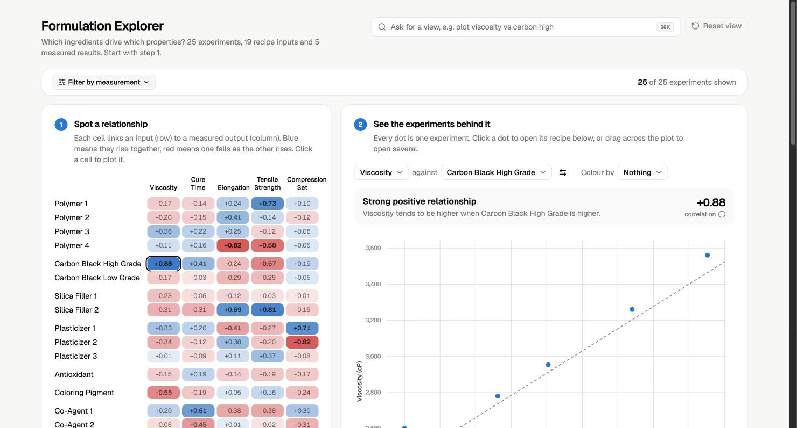
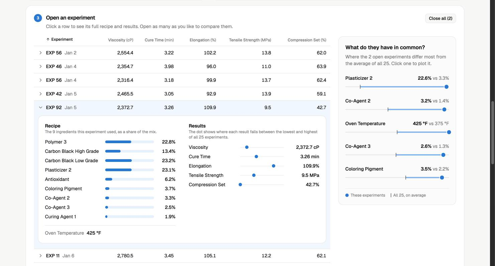

# Formulation Explorer

An interactive view of the Uncountable front-end dataset: 25 rubber-formulation
experiments, each with 19 inputs (18 ingredients plus oven temperature) and 5
measured outputs.





## Run it

Requires Node 20.19+ or 22.12+ (developed on Node 23.11, npm 10.9).

```bash
npm install
npm run dev        # http://localhost:5173
```

Other scripts:

```bash
npm test           # unit tests (Vitest)
npm run typecheck  # TypeScript, strict mode
npm run lint       # oxlint
npm run build      # production build into dist/
```

## What it does

The page reads top to bottom as three numbered steps, and anything you do in
one updates the others.

1. **Spot a relationship.** A grid of how strongly each input goes with each
   output. The stronger the link, the stronger the colour, and links strong
   enough to trust at the current sample size are set in bold. Click a cell to
   plot it.
2. **See the experiments behind it.** A scatterplot of any variable against
   any other. It says in words what it shows ("Strong positive relationship:
   Viscosity tends to be higher when Carbon Black High Grade is higher") and
   warns when there are too few experiments to rely on it. Hover a dot for its
   values; click or drag to open experiments.
3. **Open an experiment.** One compact row per experiment. Opening a row shows
   its recipe and results, and any number can be open at once. Beside the
   list, "What do they have in common?" ranks the inputs that set the open
   (or filtered) experiments apart from the rest.

Also:

- **Filter by measurement.** Tucked behind one button so the first view stays
  calm. Each output gets a range slider and a histogram; narrowing one shows,
  in blue, where the remaining experiments fall on all the others.
- **Command bar** (`⌘K`). Type a request instead of clicking:
  `plot elongation vs polymer 4`, `compression set < 55`,
  `with plasticizer 2`, `colour by oven temperature`, `sort by viscosity`,
  `clear filters`. Clauses can be joined with `and`. It shows what it
  understood before applying anything, and offers choices when a name such as
  `polymer` is ambiguous.
- **Shareable URL.** The current view is stored in the address bar, so a
  reload keeps it and a link shares it.

### A note on units

The source file does not state units. Ingredients are shown as percentages
because the app checks that every recipe adds up to 100. The other units
(°F, cP, min, MPa, %) are assumptions based on typical ranges, kept in one
map in `src/data/variableMeta.ts`.

## How it is built

React 19, TypeScript and Vite. Tailwind and a few shadcn/ui components provide
the controls. The charts are hand-written SVG and HTML; `d3-scale` is used only
to map values to pixels and colours.

```
src/
  data/        Parse and validate the JSON into a typed model
  lib/         Statistics, formatting, colour helpers
  lib/query/   The command bar's parser
  state/       View state, reducer, derived data, URL sync
  hooks/       Element size, drag-to-select
  components/  The views; charts/ holds the chart pieces; ui/ is shadcn/ui
```

Data flows one way:

1. `parseDataset` turns the raw JSON into experiments and variables. Variables
   and their families are derived from the data, so another dataset with the
   same shape loads without code changes.
2. A single `ViewState` object holds everything the user can change: axes,
   colour, filters, selection, sort and correlation method. It changes only
   through a reducer.
3. Pure functions in `state/selectors.ts` derive what each view shows.
4. Views read the state and dispatch actions. None of them talks to another
   view directly.

### Decisions worth knowing about

- **One state object, many ways to change it.** The sliders, the heatmap, the
  table and the command bar all dispatch the same actions. That is why the
  command bar needed no changes to any view, and why saving the view to the
  URL was a pair of small functions.
- **The command bar uses a parser, not a language model.** The vocabulary is
  small and closed (24 variable names and a handful of verbs), so a few
  patterns cover it. The result is instant, predictable, works offline and is
  unit tested. A model could later be added behind the same `parseQuery`
  interface for free-form questions.
- **Honest statistics for a small sample.** With 25 experiments a correlation
  below about 0.4 could easily be chance, so those cells are paler and only
  the ones beyond it are bold, and the threshold rises as filters shrink the
  sample. Strength
  and confidence are reported separately: a filtered view still says "strong
  positive relationship", and adds "with only 4 experiments, this could be
  chance". Pearson and Spearman are both offered because most ingredients are
  zero in most experiments, which makes Pearson sensitive to a few extreme
  recipes.
- **Plain language over jargon.** The page never asks the reader to know what
  "r" is. It states the relationship in a sentence and explains correlation in
  a tooltip.
- **Show less by default.** Filters, recipes and the comparison summary appear
  when asked for. Selecting an experiment and opening its details are one
  action, not two concepts.
- **Axes stay fixed while you filter.** The scatterplot always spans the whole
  dataset and keeps filtered-out experiments as faint grey dots, so you can
  see where the remaining ones sit instead of watching the axes jump.
- **Hover is separate from the main state.** It changes on every pointer move,
  so it has its own context and the list rows are memoised. Moving the mouse
  re-renders the scatterplot and the two rows whose highlight changed, not the
  whole page.
- **Nothing fails silently or blankly.** An error boundary replaces a blank
  page with a recovery screen, and the drag-to-select hook keeps its state in a
  ref so a drag faster than React can re-render is not dropped.
- **Edge cases are handled where the data enters.** Missing or non-numeric
  values become `null` and every calculation skips them; a correlation over a
  constant column or fewer than three points is `null`, never `NaN`; a
  malformed file shows an error screen; a stale or hand-edited URL falls back
  to defaults.
- **Accessibility.** The grid is one Tab stop navigated with arrow keys, each
  experiment row has a real button with `aria-expanded`, and every coloured
  cell also shows its number.

## What I would do next

- Component tests for the interactions (the logic is covered; the wiring is
  verified by hand).
- A side-by-side comparison of two or three selected experiments.
- Dark theme. The colours already live in one file (`lib/palette.ts`).
- Free-form questions in the command bar through a language model, falling
  back to it only when the parser cannot read the request.
